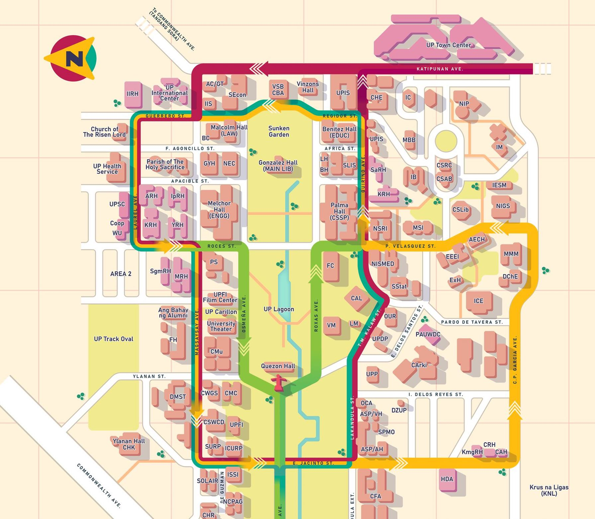
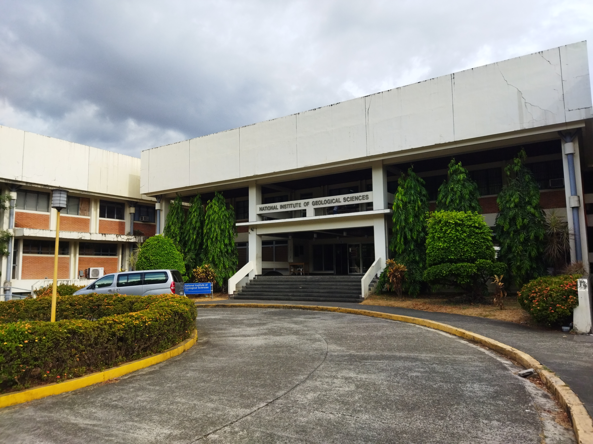
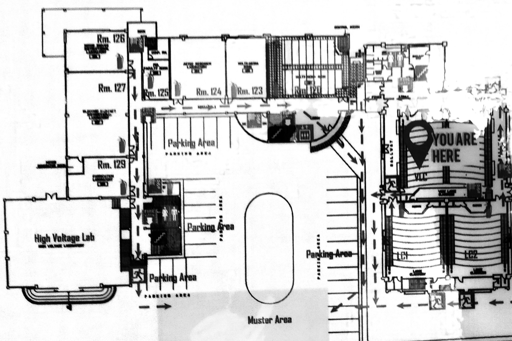

# UP Diliman Classroom Finder

This project is basically our attempt to make campus life a little less stressful. We built this as a Software Engineering project with our classmates at the University of the Philippines Diliman, and the goal was simple: help students quickly find classrooms, buildings, and relevant room details without wandering around campus aimlessly.

The app combines a campus map, building and floor plan previews, classroom search, notes, bookmarks, and a simple schedule tracker so students can plan their day more efficiently.

## Screenshots / App preview

Here are a few preview images from the app's assets to give you an idea of what the experience looks like:

<div align="center">
  
  
  
</div>

## Features

- Classroom search by building name or room number
- Campus map overview for quick navigation
- Building and floor plan images for easier room location
- Classroom details with useful information per room
- Bookmark saving for favorite classrooms
- Notes feature for reminders and tidbits
- Schedule management for tracking classes and room locations
- Local persistence using SharedPreferences for notes, bookmarks, and schedules
- Firestore-powered classroom data retrieval

## Tech stack

- Flutter
- Dart
- Firebase Firestore
- Provider for state management
- SharedPreferences for local storage
- Material Design UI components

## System architecture

This app follows a simple mobile app architecture:

- Frontend: Flutter app with multiple screens for the map, classroom detail, floor plans, schedule, notes, and bookmarks
- State management: Provider pattern via `MyAppState`
- Data layer: Firebase Firestore collection named `upclassroom` for classroom records
- Local storage: SharedPreferences for note, bookmark, and schedule persistence
- Asset layer: static campus map and floor plan image files stored in the `assets` folder

In short, the app pulls classroom data from Firestore, lets the user interact with it through a Flutter UI, and keeps personal saved info locally on the device so it stays handy even without a live backend connection.

## Installation and setup

Before you begin, make sure you have Flutter installed and configured on your machine.

1. Clone this repository:
   ```bash
   git clone <repo-url>
   cd up-diliman-classroom-finder
   ```

2. Install dependencies:
   ```bash
   flutter pub get
   ```

3. Run the app:
   ```bash
   flutter run
   ```

4. If you want to connect the app to your own Firebase project:
   - create a Firebase project in the Firebase Console
   - enable Firestore
   - configure your app using FlutterFire
   - replace or regenerate the Firebase config in `lib/firebase_options.dart`

5. Common troubleshooting:
   - run `flutter doctor` to check for missing SDK dependencies
   - ensure all emulator/device connections are working properly
   - if assets do not load, make sure the asset paths in `pubspec.yaml` are correct

## Contributors

This project was created as a team effort for our Software Engineering subject. It was built with classmates, a lot of brainstorming, and plenty of trial-and-error during development. The goal was not just to finish an assignment, but to make a useful tool that could genuinely help students around UP Diliman.

A big thank-you to everyone who contributed to the design, development, testing, and documentation of this project.

---

This app is a practical, student-focused tool meant to make navigating UP Diliman a little easier, one classroom at a time.
